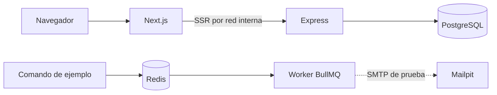

# Plantilla PERN

Base reutilizable, independiente de cualquier negocio, para iniciar proyectos web con un entorno local reproducible. La pantalla y la cola son ejemplos de infraestructura, no funcionalidades de negocio.

## Stack y arquitectura

| Área | Tecnología | Función |
|---|---|---|
| Frontend | Next.js, React, Tailwind CSS 4 | Interfaz y renderizado del servidor |
| API | Node.js, Express | API REST y lógica de aplicación |
| Persistencia | PostgreSQL, Prisma ORM y Prisma Migrate | Datos relacionales y migraciones |
| Trabajos | Redis, BullMQ y worker Node.js | Cola y procesamiento asíncrono |
| Correo local | Mailpit, Nodemailer | SMTP de prueba y bandeja local |
| Desarrollo | Docker Compose | Servicios, red y volúmenes locales |
| CI | GitHub Actions | Pruebas, ESLint, build y validación de Prisma |



Los contenedores se encuentran por nombre de servicio; `localhost` dentro de uno no apunta al anfitrión. La pantalla consulta la API desde el servidor Next.js. Las llamadas del navegador a una API de un proyecto derivado necesitan configurar su ruta u origen y, si procede, CORS. La cola de demostración no procesa tareas de negocio. Redis usa AOF, `noeviction` y contraseña de desarrollo; no publica puerto. Redis 8 tiene sus propias [opciones de licencia](https://redis.io/legal/licenses/).

## Requisitos y arranque

Se necesitan Git, Docker Engine 28 o posterior y el plugin Docker Compose 2.17 o posterior. No se necesita Node.js en el anfitrión. Los puertos predeterminados deben estar disponibles.

```bash
git clone https://github.com/sadamlg/pern-template.git
cd pern-template
cp .env.example .env
docker compose config --quiet
docker compose up --build --detach --wait --wait-timeout 180
docker compose ps
```

Los valores de `.env.example` son exclusivamente locales. `.env` no se versiona; usa secretos y configuración separados para cada entorno. Si cambias la contraseña de PostgreSQL, actualiza también `DATABASE_URL`, con caracteres codificados para URL; cambiar variables no modifica un volumen de base de datos ya inicializado.

| Servicio | Dirección en el anfitrión |
|---|---|
| Frontend | http://localhost:3000 |
| API y salud de PostgreSQL | http://localhost:4000/health |
| API de ejemplo | http://localhost:4000/api/hello |
| Mailpit | http://localhost:8025 |
| PostgreSQL | localhost:5432 |
| Redis y SMTP | Sólo red interna de Compose |

Comprueba los recorridos:

```bash
curl --fail http://localhost:4000/health
docker compose exec backend npm run prisma:validate
docker compose exec worker npm run queue:demo
docker compose exec worker npm run worker:mail-smoke
```

El comando de cola espera hasta 30 segundos a que el worker complete el trabajo. Abre Mailpit para confirmar el correo. El healthcheck del worker comprueba conectividad Redis, mientras que `queue:demo` comprueba el procesamiento completo.

## Acceso LAN

En una red confiable, identifica la IPv4 del anfitrión y ejecuta:

```bash
scripts/dev-lan.sh up 192.168.1.20
# Al terminar:
scripts/dev-lan.sh off
```

El script publica temporalmente frontend, API y la bandeja de Mailpit en las interfaces IPv4, configura el origen de desarrollo de Next.js y establece `MEDIA_BASE_URL` con la IP LAN y el puerto del frontend. Las apps derivadas que generen URL absolutas de medios deben usar esa variable para que el otro dispositivo llegue al anfitrión, no a su propio `localhost`. Abre la IP indicada en los puertos anteriores desde otro equipo. PostgreSQL permanece en localhost; Redis y SMTP no se publican. La bandeja puede contener datos sensibles: utiliza sólo datos de prueba y una red confiable. El firewall puede requerir configuración. El script restaura los enlaces definidos en `.env` al desactivar LAN.

## Trabajo diario

```bash
docker compose logs --follow
docker compose restart frontend backend
docker compose up --detach --force-recreate frontend backend
docker compose up --build --detach --force-recreate frontend backend
docker compose down
```

`restart` reinicia procesos; recrear aplica cambios de entorno; reconstruir aplica cambios de dependencias, Dockerfiles o configuración copiada a la imagen. `down` conserva los volúmenes de PostgreSQL y Redis. `docker compose down --volumes` los elimina junto con sus datos.

Al agregar modelos a `backend/prisma/schema.prisma`, crea la migración desde el contenedor y genera el cliente explícitamente:

```bash
docker compose exec --user "$(id -u):$(id -g)" --env HOME=/tmp backend npm run prisma:migrate:dev -- --name nombre_descriptivo
docker compose exec backend npm run prisma:generate
docker compose exec backend npm run prisma:migrate:status
```

`migrate dev` es para desarrollo; `npm run prisma:migrate:deploy` aplica migraciones versionadas. Evita confirmar un reset si necesitas conservar datos. Las dependencias se fijan mediante lockfiles y se instalan con `npm ci`.

## Ramas, CI y despliegue

`develop` es la rama predeterminada de integración y `main` conserva la versión estable. Ambas están protegidas: requieren PR y los tres checks de CI, incluso para administradores; no permiten force-push ni eliminación. GitHub elimina automáticamente las ramas de origen fusionadas. El workflow ejecuta pruebas y lint de ambos componentes, build de frontend, validación y generación Prisma y una prueba de Compose. Los repositorios derivados deben configurar sus propias protecciones en GitHub; el archivo de CI no las activa por sí solo.

Compose es un entorno de desarrollo, no una configuración de producción. Para desplegar un proyecto derivado hay que elegir proveedor y configurar servicios, secretos, red privada, TLS, persistencia, backups, migraciones, observabilidad y recuperación. No se incluyen credenciales ni recursos de producción.


La [guía de Docker Compose](docs/docker/COMPOSE.md) detalla los servicios, las comprobaciones, el acceso LAN y el flujo de desarrollo.
