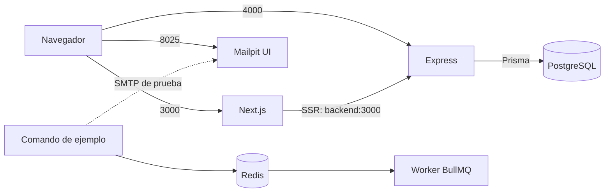

# Entorno local con Docker Compose

Esta guía describe la configuración incluida en el repositorio, desde una copia limpia hasta la ejecución y comprobación de todos los servicios. Los archivos ejecutables son la fuente de verdad para versiones, variables y comportamiento; evita copiar configuraciones de memoria al actualizar el stack.

## Requisitos

- Git, `curl` y Bash en Linux, macOS o WSL 2.
- Docker Engine 28 o posterior en ejecución y Docker Compose plugin 2.17.0 o posterior (`docker compose`). Engine 28 corrige un problema por el cual equipos del mismo segmento podían alcanzar puertos publicados en localhost. Consulta [publicación de puertos](https://docs.docker.com/engine/network/port-publishing/) y [Compose 2.17](https://github.com/docker/compose/releases/tag/v2.17.0).
- No se necesita Node.js ni npm en el anfitrión. Las imágenes usan los lockfiles e instalan con `npm ci`.

## Red y servicios

Compose crea una red bridge y resuelve los contenedores por nombre de servicio. El navegador usa los puertos publicados en el anfitrión. `localhost` dentro de un contenedor apunta a ese contenedor, no al anfitrión ni a otro servicio.



| Servicio | Dirección interna | Acceso predeterminado desde el anfitrión | Función |
|---|---|---|---|
| Frontend | `frontend:3000` | `localhost:3000` | Next.js en desarrollo y consulta SSR a la API |
| Backend | `backend:3000` | `localhost:4000` | Express y comprobación de PostgreSQL |
| PostgreSQL | `postgres:5432` | `localhost:5432` | Datos relacionales y migraciones Prisma |
| Redis | `redis:6379` | Sin puerto publicado | Cola BullMQ persistida en Redis |
| Worker | Sin puerto HTTP | Sin puerto publicado | Procesa la cola de demostración |
| Mailpit | `mailpit:1025` SMTP, `mailpit:8025` UI | `localhost:8025` | Captura correo de prueba; SMTP privado |

Los enlaces publicados usan `127.0.0.1` por defecto. La pantalla consulta Express desde el servidor Next.js mediante `INTERNAL_API_URL`; el navegador no resuelve `backend`. Un proyecto derivado que llame a la API desde el navegador deberá definir su ruta u origen y la política CORS correspondiente.

## Imágenes y configuración

| Componente | Imagen o dependencia principal | Configuración |
|---|---|---|
| Frontend y backend | `node:24.21.0-bookworm-slim` | Dockerfiles con `npm ci`, ejecutados como `node` |
| PostgreSQL | `postgres:18.6-bookworm` | Volumen `postgres_data` en `/var/lib/postgresql` |
| Redis | `redis:8.10.2-trixie` | Contraseña, AOF, `noeviction` y volumen `redis_data` en `/data` |
| Mailpit | `axllent/mailpit:v1.31.5` | Bandeja temporal sin volumen persistente |
| Aplicaciones | Next.js, React, Tailwind CSS, Express, Prisma, BullMQ, ioredis y Nodemailer | Versiones fijadas en los manifiestos y lockfiles |

Consulta los [tags de Node](https://github.com/docker-library/official-images/blob/master/library/node), la [imagen PostgreSQL](https://hub.docker.com/_/postgres), las [recomendaciones de BullMQ para Redis](https://docs.bullmq.io/guide/going-to-production) y la [documentación de Mailpit](https://mailpit.axllent.org/docs/install/docker/) al actualizar. Redis 8 tiene sus propias [opciones de licencia](https://redis.io/legal/licenses/).

El frontend monta `src/`, `tests/` y `public/`; el backend y el worker montan `src/`, `prisma/` y la configuración Prisma. La API genera el cliente y aplica migraciones versionadas antes de iniciar. El cliente se genera en `backend/generated/prisma`, fuera de `src/`. El worker comparte la imagen del backend, se conecta a Redis y procesa trabajos de ejemplo. Su healthcheck comprueba un `PING` a Redis; la prueba de cola comprueba además que el proceso complete un trabajo.

## Configurar y arrancar

Desde la raíz de una copia del repositorio:

```bash
cp -n .env.example .env
docker compose config --quiet
docker compose up --build --detach --wait --wait-timeout 180
docker compose ps
```

`cp -n` conserva un `.env` existente. Los valores de ejemplo son sólo para desarrollo; `.env` está excluido de Git. Si cambias usuario, base o contraseña de PostgreSQL, actualiza también `DATABASE_URL` y codifica los caracteres especiales para una URL. Cambiar las variables de inicialización no cambia las credenciales de un volumen PostgreSQL ya creado. Cambia los puertos en `.env` si hay conflictos.

La primera ejecución descarga imágenes, construye las aplicaciones, instala dependencias, crea la red y los volúmenes, y espera a los healthchecks. Si falla, revisa `docker compose ps` y `docker compose logs --follow <servicio>`.

## Comprobar el entorno

```bash
curl --fail --show-error http://localhost:4000/health
curl --fail --show-error http://localhost:4000/api/hello
curl --fail --show-error --output /dev/null --write-out 'HTTP %{http_code}\n' http://localhost:3000
docker compose exec -T backend npm run prisma:validate
docker compose exec -T redis sh -c 'REDISCLI_AUTH="$REDIS_PASSWORD" redis-cli ping'
docker compose exec -T worker npm run queue:demo
docker compose exec -T worker npm run worker:mail-smoke
```

La API de salud devuelve `status: ok` y `database: connected`; Redis responde `PONG`. El comando de cola espera hasta 30 segundos al resultado del worker. El mensaje SMTP aparece en [Mailpit](http://localhost:8025); se pierde al recrear ese contenedor. Abre [el frontend](http://localhost:3000) para comprobar el estado de conexión a la API. Si cambiaste puertos, sustituye los de los ejemplos.

## Prisma y desarrollo diario

Al agregar modelos al esquema, crea una migración local y genera el cliente. El UID/GID del anfitrión permite editar la migración creada en el directorio montado:

```bash
docker compose exec --user "$(id -u):$(id -g)" --env HOME=/tmp backend npm run prisma:migrate:dev -- --name nombre_descriptivo
docker compose exec backend npm run prisma:generate
docker compose exec backend npm run prisma:migrate:status
```

`migrate dev` crea y aplica migraciones de desarrollo; Prisma 7 necesita generar el cliente explícitamente después. `npm run prisma:migrate:deploy` aplica migraciones ya versionadas. No confirmes un reset si necesitas conservar datos. Consulta la [referencia de Prisma CLI](https://www.prisma.io/docs/orm/v7/reference/prisma-cli-reference).

```bash
docker compose exec -T backend npm test
docker compose exec -T backend npm run lint
docker compose exec -T frontend npm test
docker compose exec -T frontend npm run lint
docker compose run --rm --no-deps frontend npm run build
```

El build se ejecuta en un contenedor temporal: ejecutarlo dentro del frontend de desarrollo activo puede sobrescribir `.next` e interrumpir el servidor. Si sucede, recrea el frontend con `docker compose up --detach --force-recreate frontend`.

## Acceso LAN

En una red confiable, sustituye el ejemplo por la IPv4 actual del anfitrión:

```bash
scripts/dev-lan.sh up 192.168.1.20
scripts/dev-lan.sh off
```

`up` configura `NEXT_ALLOWED_DEV_ORIGIN`, publica frontend, API y Mailpit en **todas** las interfaces IPv4 (`0.0.0.0`) y muestra las URL para la IP indicada. El firewall puede necesitar reglas para los puertos publicados. Usa datos de prueba: la bandeja no tiene autenticación. PostgreSQL conserva el enlace configurado en `.env` (localhost por defecto); Redis y SMTP no se publican. El script crea `.env.dev-lan` sin modificar `.env`; `off` recrea los servicios con la configuración base y elimina ese archivo. Los volúmenes se conservan.

## CI, reinicio y limpieza

GitHub Actions ejecuta pruebas y ESLint de frontend y backend, build de Next.js, validación y generación Prisma, y arranca Compose para comprobar cola y SMTP. Los checks se ejecutan en PR y pushes a `develop` y `main`. Los repositorios derivados deben configurar sus propias protecciones de rama.

```bash
docker compose logs --follow
docker compose restart frontend backend worker
docker compose up --detach --force-recreate frontend backend worker
docker compose up --build --detach --force-recreate
docker compose down
```

Reiniciar conserva los contenedores; recrearlos aplica variables y cambios de Compose; reconstruir aplica dependencias, Dockerfiles y configuración copiada a las imágenes. `down` conserva los volúmenes. `docker compose down --volumes` elimina permanentemente los datos locales de PostgreSQL y Redis; no lo uses como primer recurso al investigar un fallo.
